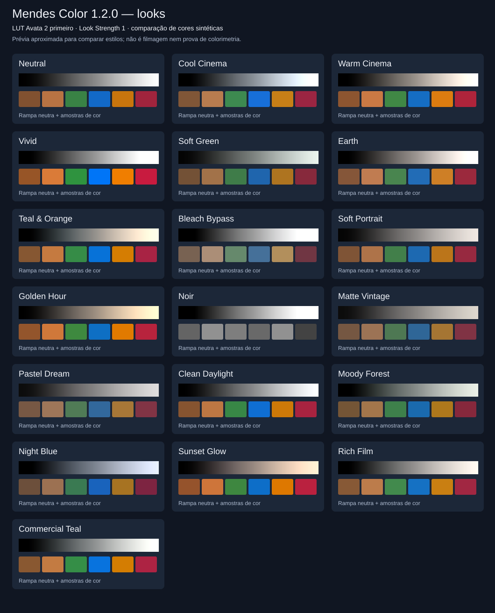

# Looks cinematográficos — Mendes Color 1.4.0

Todos os estilos operam **depois** da transformação de entrada. Para sua Avata 2,
selecione primeiro **Input LUT → DJI Avata 2 D-Log M to Rec.709 (embedded)**.
Mantenha LUT Output Transfer=Keep LUT output, Creative Gamma=1 e a saída/
monitoramento do fluxo manual no Resolve em Rec.709 Gamma 2.4.

A LUT enviada não foi alterada nem incorporada uma segunda vez a cada look.
Ao trocar estilos, a mesma conversão técnica continua sendo usada como base.

| Look no menu | Aparência proposta |
|---|---|
| Neutral | Conversão e ajustes manuais, sem estilo adicional |
| Cool Cinema | Balanço frio, contraste marcado e saturação ligeiramente reduzida |
| Warm Cinema | Balanço quente e contraste moderado |
| Vivid | Mais contraste e saturação |
| Soft Green | Verde suave, contraste e saturação contidos |
| Earth | Tons quentes e terrosos, saturação reduzida |
| Teal & Orange | Sombras verde-azuladas e luzes quentes, com roll-off de altas luzes |
| Bleach Bypass | Alto contraste, forte redução de saturação e ombro suave |
| Soft Portrait | Calor delicado, contraste suave e altas luzes contidas |
| Golden Hour | Aparência quente de fim de tarde, separação sutil entre sombras e luzes |
| Noir | Preto e branco contrastado, com altas luzes suavizadas |
| Matte Vintage | Pretos levantados, cores desbotadas e calor sutil |
| Pastel Dream | Imagem mais clara, contraste baixo e cores suaves |
| Clean Daylight | Ajuste discreto e limpo para cenas diurnas |
| Moody Forest | Verde em regiões mais escuras, imagem densa e saturação contida |
| Night Blue | Azul frio, menor exposição criativa e contraste marcado |
| Sunset Glow | Quente com magenta sutil, sensação de pôr do sol |
| Rich Film | Contraste rico, leve matte e compressão gradual de altas luzes |
| Commercial Teal | Contraste e saturação moderados, sombras verde-azuladas e luzes levemente quentes |

## Famílias adicionais da 1.4.0

O menu agora tem **84 opções**, incluindo Neutral e os 18 estilos acima.
Os primeiros 19 índices não mudaram. Foram acrescentadas **65 receitas próprias**,
identificadas como **(Mendes)**:

| Família | Variações | Direção estética |
|---|---:|---|
| Signature | 01–11 | Contraste, matte, densidade e balanço variados |
| Cinema Blue | 01–12 | Balanço frio e sombras azuladas |
| Cinema Warm | 01–11 | Calor e altas luzes quentes |
| Commercial | 01–12 | Contraste limpo e separação verde-azulada |
| Ethereal Green | 01–07 | Verde suave, cores contidas e pretos elevados |
| Terra Tones | 01–12 | Calor terroso e saturação moderada |

Essas receitas não contêm os dados das LUTs comerciais do ToneLab. Nomes de
família descrevem uma direção visual; os resultados não foram comprovados
idênticos aos daquele produto. Finishing Tones oferece outros 17 acabamentos
próprios em uma seção separada, com mistura independente.

## Intensidade e uso

Use **ANTERIOR** e **PRÓXIMO** após Creative Look para comparar estilos sem
abrir o menu. A navegação é circular e não altera a LUT, Look Strength ou os
demais controles. O menu continua disponível para escolher qualquer estilo.

- **Look Strength=0**: conserva a LUT e a sua correção manual.
- **Look Strength=0,5**: mistura em partes iguais o resultado sem estilo e o
  resultado estilizado, ambos depois da LUT.
- **Look Strength=1**: estilo completo. O controle pode ser animado no host.
- **Effect Mix=0**: bypass do plugin inteiro, incluindo a conversão D-Log M.

A seção [Halation](HALATION.md) acrescenta halo quente em altas luzes depois
do look, com presets Desligado/Mínimo/Médio/Alto e seus próprios botões.
Look Strength=0 não desliga Halation; para isso use Halation Preset=Desligado.

Comece com 0,4–0,8 em Golden Hour, Sunset Glow, Moody Forest e Commercial Teal;
adapte à luz, exposição e balanço de branco da sua filmagem. Os nomes descrevem
intenções estéticas, não emulações de filmes, presets do ToneLab, mudanças
físicas de iluminação ou proteção seletiva de pele.

Os estilos novos combinam balanço, contraste, saturação e, conforme o look,
coloração por zonas tonais, elevação de preto e compressão suave das altas luzes.
Não há hard clipping adicional do motor. Os seis looks antigos mantêm os seus
valores e índices originais; o identificador e nomes internos dos controles
existentes foram preservados.

## Comparação visual

Esta figura histórica mostra apenas os 19 looks iniciais e foi calculada pelo motor C++ do plugin, usando a LUT embutida
e Look Strength=1, com Halation desligada. Mostra códigos RGB de rampas e amostras sintéticas, limitados
a 0–1 para exibição SVG. Não é uma comparação fotográfica, uma simulação exata
do seu monitor ou certificação colorimétrica. Para regenerar: `make preview`.

## Verificação

Há testes para aparência quente, sombras verdes/azuladas, saída monocromática,
pretos matte, compressão de altas luzes, intensidade intermediária e valores
inválidos. Todas as opções foram exercitadas em rampas com valores negativos e
acima de 1. Testes com a LUT fornecida e o host OpenFX simulado confirmam que
Look Strength=0 preserva a normalização da câmera e que o estilo acontece depois
dela. A validação visual na sua filmagem e no Resolve real permanece pendente.
