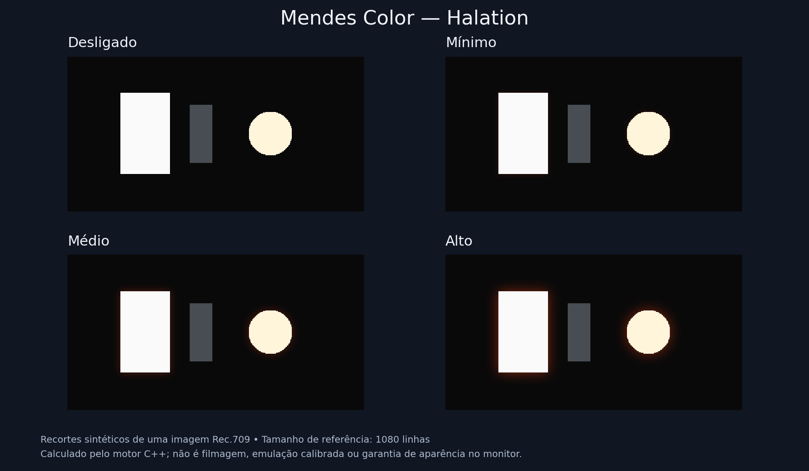

# Mendes Color 1.3.0 — Halation e navegação rápida

Plugin OpenFX para DaVinci Resolve no Windows x64, com LUT Avata 2,
19 looks, Halation e botões ANTERIOR/PRÓXIMO nos menus.

## Download e atualização

**[Baixar MendesColor-1.3.0-Setup.exe](MendesColor-1.3.0-Setup.exe?raw=true)**

1. Feche o DaVinci Resolve.
2. Abra o Setup, autorize a solicitação de administrador do Windows e confirme o destino.
3. Reabra o Resolve e procure **Mendes Color** em **Effects / Open FX**, grupo **Mendes**.

O instalador funciona offline e instala na pasta OpenFX automaticamente.
Ele verifica os arquivos por SHA-256 e guarda a versão anterior em
`C:\Program Files\Common Files\MendesColor\Backups\`.
Se o Resolve estiver aberto, pede que você o feche; não encerra seus projetos.
Nas próximas atualizações, execute o Setup da nova versão da mesma forma.

O executável não tem assinatura digital de editor; o Windows pode exibir
confirmação adicional. Confira a origem e o SHA-256 antes de executar.

- [SHA-256 dos downloads](SHA256SUMS.txt)
- [Verificação técnica do instalador](MendesColor-1.3.0-Setup-verification.json)
- [Pacote portátil Windows](MendesColor-1.3.0-Windows-x64.zip)
- [Código-fonte completo](MendesColor-1.3.0-source.zip)

## Halation

Abra a aba ou seção **Halation** e escolha **Halation Preset**:

| Opção | Aparência |
|---|---|
| Desligado | Sem halo; padrão para preservar projetos existentes |
| Mínimo | Halo quente discreto e mais estreito |
| Médio | Halo mais visível e espalhado |
| Alto | Halo mais intenso e amplo |

O halo vermelho-alaranjado aparece ao redor das altas luzes, depois da LUT e do
look, antes de Effect Mix. Comece em Mínimo e compare uma cena com janelas,
reflexos ou sol junto de áreas mais escuras. O tamanho acompanha a resolução,
a escala da prévia e a proporção dos pixels. O alfa é preservado.

[Guia da Halation](HALATION.md)

A figura usa o mesmo motor C++ em dados sintéticos de RGB de exibição. Não é
filmagem, emulação calibrada de película ou garantia da aparência no monitor.

## Botões ANTERIOR e PRÓXIMO

Os quatro menus **Creative Look**, **Input LUT**, **LUT Output Transfer** e
**Halation Preset** têm botões **ANTERIOR / PRÓXIMO**. Cada clique troca uma
opção do menu correspondente. Depois da última, PRÓXIMO volta à primeira;
ANTERIOR na primeira vai para a última. Os menus continuam disponíveis.

A navegação preserva os demais ajustes. Em Look/Halation já animados, atualiza
somente o tempo atual sem alterar os outros keyframes; sem animação prévia,
não cria keyframes. As alterações são agrupadas para desfazer pelo host.
O layout dos botões, abas e seções depende da interface OpenFX do Resolve.

Os botões de Input LUT alternam os modos; em Custom ainda é preciso selecionar
um arquivo em LUT File. Para a LUT enviada, mantenha **LUT Output Transfer →
Keep LUT output**. A outra opção é uma recodificação avançada que depende da
curva de saída documentada da LUT.

## Looks sobre a conversão da Avata 2

Com os arquivos originais D-Log M, selecione **Input LUT → DJI Avata 2 D-Log M
to Rec.709 (embedded)**. A mesma conversão acontece primeiro, uma única vez;
escolha depois o estilo em **Creative Look**, ou use os botões de navegação.
No fluxo manual, mantenha Creative Gamma=1 e configure saída/monitoramento
Rec.709 Gamma 2.4 no Resolve. Não normalize o mesmo sinal duas vezes.

| Estilo desejado | Look |
|---|---|
| Quente cinematográfico | Warm Cinema / Golden Hour |
| Fim de tarde | Golden Hour |
| Pôr do sol | Sunset Glow |
| Verde cinematográfico | Moody Forest / Soft Green |
| Comercial com verde e azul | Commercial Teal |
| Sombras frias e luzes quentes | Teal & Orange |

**Look Strength** dosa apenas o estilo: zero mantém a LUT, as correções manuais
e a Halation selecionada. Para desligar só o halo use Halation Preset=Desligado.
**Effect Mix=0** desliga o plugin inteiro, incluindo a LUT.

[Catálogo de looks](LOOKS.md)

## Validação

Passaram **4.860 verificações locais**: 2.235 de cor, 166 de LUT/transferências,
2.100 de Halation, 338 de host OpenFX simulado e 21 de instalação/backup/restauração.
Também passaram ASan/UBSan com detecção de vazamentos. Os testes espaciais
comparam imagem inteira e tiles, source ROI recortada, alfa, stride negativo,
ROI, escala/PAR, mistura, cancelamento e resposta de impulso analítica.
Os botões foram testados nos quatro menus, incluindo passagem circular,
keyframes, notificações e falha de escrita com fechamento do grupo de desfazer.

O REA inspecionou as exportações/importações do plugin e os recursos do Setup.
Os **13 payloads** e o manifesto UAC foram conferidos no EXE final.
A interface e as APIs Windows do instalador, o layout/undo do host e a aparência
na filmagem real ainda precisam ser verificados no Resolve do usuário.
A versão 1.0.2 do plugin foi confirmada pelo usuário. O processamento é CPU,
RGBA float32, sem promessa de desempenho em tempo real, especialmente em 4K.

A LUT enviada foi preservada byte a byte com sua proveniência. O nome identifica
Avata 2; um comentário interno menciona Mavic 3 Pro. Ela não declara gamma de
saída, preservado por padrão. Configurar Rec.709 Gamma 2.4 no projeto não prova
uma curva 2.4 na LUT. Os algoritmos e looks são próprios e não reproduzem ToneLab.
As versões anteriores continuam disponíveis como histórico.

## Análise do ToneLab fornecido

[Mapa das 13 seções, menus, faixas e padrões](ToneLab-Analise.md) ·
[Relatório e evidências para download](ToneLab-Analise-Do-Plugin.zip)

Esse inventário descreve o arquivo fornecido pelo usuário. A versão publicada
do Mendes Color permanece 1.3.0; a análise não adiciona automaticamente essas
ferramentas ao plugin e não estabelece equivalência visual com o ToneLab.
