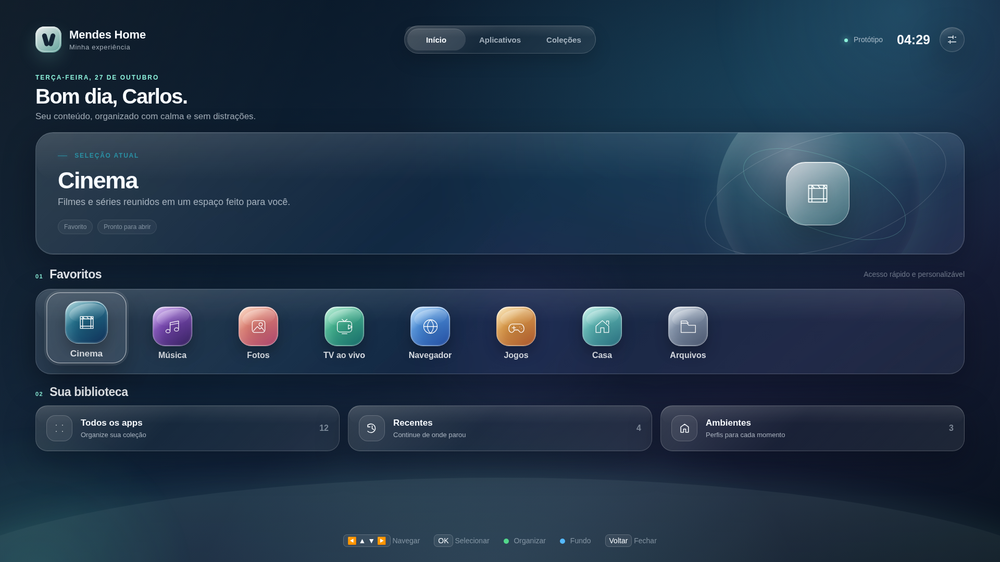

# LG webOS Launcher

Projeto original para uma interface inicial rápida e personalizável na LG 55UR8750PSA, usando somente o fluxo oficial de desenvolvimento do LG webOS TV.

## Avaliar o protótipo visual

[**Baixar Mendes Home — pacote leve**](dist/Mendes-Home-Prototipo-LEVE.zip?raw=1)

Depois de baixar:

1. extraia o ZIP;
2. abra `ABRIR-MENDES-HOME.cmd`;
3. pressione `F11` para avaliar em tela cheia.

Também é possível abrir o [arquivo HTML independente](dist/Mendes-Home-Prototipo.html) diretamente no navegador.



## Estado atual

- Sistema identificado: LG webOS TV.
- TV registrada: 55UR8750PSA, webOS 24 / 9.2.1-40, firmware informado `lgtv23crtk108312530`.
- Computador: Windows 11.
- Método: Developer Mode app + Key Server + CLI oficial na porta 9922.
- CLI fixada: `@webos-tools/cli` 3.2.6, perfil `tv`.
- Nenhuma modificação foi feita na TV.
- Rede confirmada no Windows: Wi-Fi, IPv4 `192.168.0.103`, gateway `192.168.0.1`.
- TV confirmada na mesma rede: IPv4 `192.168.0.108`.
- Comunicação pela rede: confirmada por duas respostas em aproximadamente 4 ms.
- Aplicativo oficial Developer Mode: instalado.
- Estado atual: Dev Mode Status `ON`, Key Server `OFF`, Session Time `999h:57m`.
- IP confirmado pelo aplicativo Developer Mode: `192.168.0.108`.
- Comunicação oficial confirmada: TCP 9922 acessível do Windows para a TV.
- Key Server ativado com autorização; TCP 9991 acessível do Windows para a TV.
- Rede pronta para pareamento: portas 9922 e 9991 confirmadas.
- Ferramentas base confirmadas no Windows: Node.js `v24.20.0` e npm `11.19.0`.
- Pasta local criada em Documentos e CLI oficial `@webos-tools/cli` 3.2.6 confirmada.
- Perfil `tv` selecionado e dispositivo local `lg-sala` registrado como `prisoner@192.168.0.108:9922`.
- Chave de desenvolvimento obtida e salva localmente como `%USERPROFILE%\.ssh\lg-sala_webos`.
- Pareamento confirmado por `ares-device`: modelo `55UR8750PSA`, SDK `9.2.1`, firmware `23.21.20`.
- Key Server desligado após o pareamento; a conexão por chave continua funcional.
- Preparação concluída: sistema, rede, CLI, pareamento e limites confirmados.
- Permissão SSH confirmada como usuário restrito `prisoner`, sem root.
- Canal SSAP disponível nas portas TCP 3000 e 3001; candidato a automação externa de inicialização.
- Investigação da etapa 2 concluída e registrada em `docs/03-INVESTIGACAO-ETAPA-2.md`.
- Etapa atual: protótipo visual navegável do Mendes Home pronto para avaliação local.
- O protótipo ainda não foi instalado na TV e usa somente aplicativos demonstrativos.

Leia primeiro [o perfil e os limites](docs/01-PERFIL-E-LIMITES.md) e depois siga [a primeira conexão](docs/02-PRIMEIRA-CONEXAO.md).

Para avaliar a etapa 3, abra `prototype/ABRIR-PROTOTIPO.cmd`. A documentação do protótipo está em [docs/04-PROTOTIPO-VISUAL-ETAPA-3.md](docs/04-PROTOTIPO-VISUAL-ETAPA-3.md).

## Primeiro passo no Windows

Dê dois cliques em:

```text
INICIAR-DIAGNOSTICO.cmd
```

Envie somente estas três linhas do resultado:

```text
Interface recomendada:
IPv4 do computador:
Gateway:
```

Não envie senhas, chaves ou dados da conta LG Developer.
